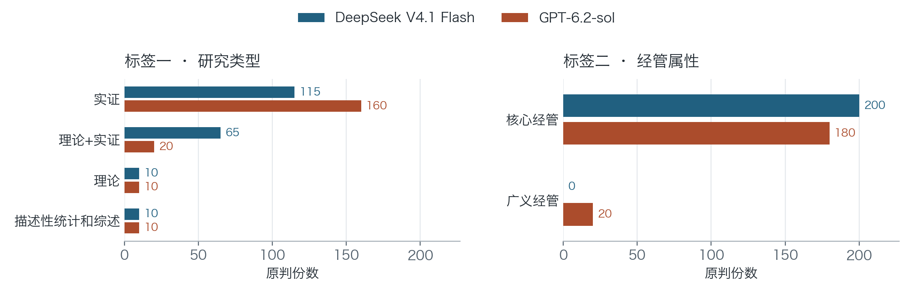
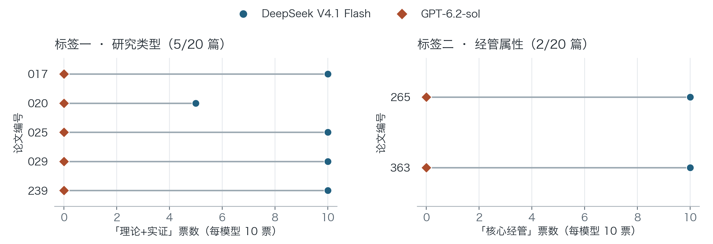
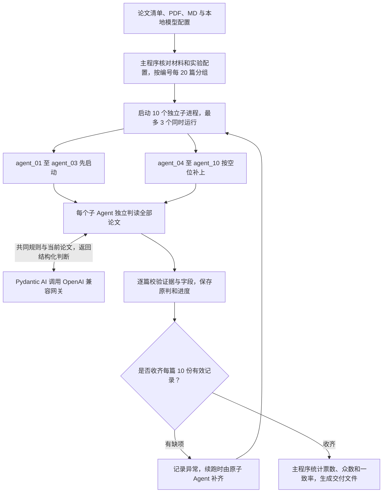
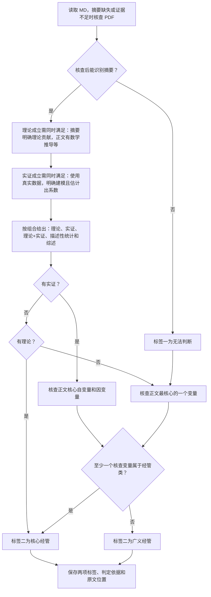

# Paper Scoring · 论文双标签独立判定

使用 Pydantic AI 对论文独立判定研究类型和经管属性，并保留逐篇依据、投票和人工复核材料。正式批次包含「新旧结果不一致」组的 20 篇论文。10 个子 Agent 各判读全部 20 篇，最多同时运行 3 个。

## 双模型实验结果

DeepSeek V4.1 Flash 和 GPT-6.2-sol 使用相同的 20 篇论文、材料和逐步骤判定规则。每个模型由 10 个独立子 Agent 各判读 20 篇，实际最高并发均为 3。

| 指标 | DeepSeek V4.1 Flash | GPT-6.2-sol |
| --- | ---: | ---: |
| 有效原判 | 200 / 200 | 200 / 200 |
| 标签一获组内 10 票一致 | 19 / 20 篇 | 20 / 20 篇 |
| 标签二获组内 10 票一致 | 20 / 20 篇 | 20 / 20 篇 |
| 两个标签均获组内 10 票一致 | 19 / 20 篇 | 20 / 20 篇 |

### 标签分布



两组共有 **5 篇论文的标签一众数集合不同**。GPT 在这 5 篇上都给出 10 票「实证」。DeepSeek 对 4 篇给出 10 票「理论+实证」，第 020 篇两类各 5 票。每篇的 10 票用于衡量同一论文的重复判读一致性。

### 逐篇分歧



- **标签一的分歧集中在摘要的理论贡献门槛。** 例如，017 的摘要报告结构估计和模拟，明确描述模型构建的内容出现在正文。按 Step 1.2 核查，原文支持 GPT 的「实证」判定。025 的摘要提到均衡模型估计，是否已明确声明理论贡献仍有解释空间。
- **标签二在 265 和 363 上分歧。** DeepSeek 两篇均给出 10 票「核心经管」，GPT 均给出 10 票「广义经管」。在抽查的理由里，DeepSeek 侧重变量在经管研究中的用途，GPT 侧重变量直接测量的内容。

一致率反映重复判读的稳定性。论文来自同一批样本，两个模型使用不同网关，网关对请求参数的实际处理无法通过本地记录独立核验。

### 下载结果与复现图表

- [模型对比报告与原文复核](results/step-evidence-comparison/模型对比报告.md) · [逐篇票数 CSV](results/step-evidence-comparison/逐篇票数.csv)
- **DeepSeek V4.1 Flash**　[Excel 汇总](results/step-evidence-comparison/deepseek-v4.1-flash/标签一二-10个Agent独立打标汇总.xlsx) · [PDF 明细](results/step-evidence-comparison/deepseek-v4.1-flash/PDF-每组详细判定/) · [Markdown 明细](results/step-evidence-comparison/deepseek-v4.1-flash/MD-每组详细判定/) · [程序验收](results/step-evidence-comparison/deepseek-v4.1-flash/验收报告.md) · [配置与原判 JSON](results/step-evidence-comparison/deepseek-v4.1-flash/provenance/)
- **GPT-6.2-sol**　[Excel 汇总](results/step-evidence-comparison/gpt-6.2-sol/标签一二-10个Agent独立打标汇总.xlsx) · [PDF 明细](results/step-evidence-comparison/gpt-6.2-sol/PDF-每组详细判定/) · [Markdown 明细](results/step-evidence-comparison/gpt-6.2-sol/MD-每组详细判定/) · [程序验收](results/step-evidence-comparison/gpt-6.2-sol/验收报告.md) · [配置与原判 JSON](results/step-evidence-comparison/gpt-6.2-sol/provenance/)

请克隆仓库或整目录下载后打开 Excel。每个工作簿的 400 个明细链接均使用相对路径。

[Matplotlib 绘图脚本](scripts/plot_results.py) 直接读取两组已发布的原判 JSON。安装 `matplotlib>=3.7` 后运行 `python scripts/plot_results.py` 即可生成两张图。需要指定中文字体时使用 `--font <字体文件>`。

## 架构图 · 主程序与子 Agent



每个子进程创建一个具名的 Pydantic AI `Agent`。每次 `Agent.run()` 使用新上下文，包含共同规则、当前论文材料和必要的校验提示。主程序负责并发调度、断点续跑和一致率统计。框架选型见 [设计记录](docs/decisions/001-agent-framework.md)。

## 流程图 · 一篇论文如何打两个标签



PDF 文本仍无法支持判定时，子 Agent 可请求核查最多 4 张指定页图。材料不足时记录异常。模型提交步骤判断和证据，程序按照 [评分规则](paper_scoring/rubric.md) 校验并计算标签。[两张原图的 PDF](docs/agent-team-diagrams.pdf) 可单独下载。

## 安装和准备材料

需要 Python 3.11 或更高版本。进入克隆后的仓库目录，运行：

```bash
python3 -m venv .venv
source .venv/bin/activate
python -m pip install -e .
cp -n .env.example .env
```

在本地 `.env` 填写 `PAPER_SCORING_API_KEY`，其余配置可从 [.env.example](.env.example) 开始。已有同名系统环境变量时，系统环境变量优先。公开仓库只包含配置示例。

正式结果可直接查看。要重新判读，请按 [papers.toml](papers.toml) 放置有权使用的材料，或准备自己的清单。`pdf_dir`、`md_dir` 和 `instructions` 以清单所在目录为基准。每个编号需要一份 PDF 和一份 UTF-8 Markdown，两份文件使用相同的 `编号-标题` 文件名主体，例如 `017-论文标题.pdf` 和 `017-论文标题.md`。`ids` 保留前导零。文件名中的标题被截断时，可用 `[titles]` 补齐。

正式批次的源论文和指令 PDF 需在本地提供。自定义批次可省略 `instructions` 字段。该字段用于记录正式指令的文件指纹，实际执行的判定规则随源码提供。

## 运行与续跑

```bash
python -m paper_scoring check
python -m paper_scoring doctor
python -m paper_scoring run --smoke
python -m paper_scoring run
```

| 命令 | 用途 |
| --- | --- |
| `check` | 本地核对材料配对和可读性，无需 API Key。 |
| `doctor` | 用合成内容检查网关模型列表、JSON 响应和已启用的页图能力，可能产生少量费用。 |
| `run --smoke` | 1 个 Agent 判读清单首篇，默认写入 `runs/smoke/`。 |
| `run` | 10 个 Agent 各判读整份清单，默认写入 `runs/新旧结果不一致-标签一二/`。 |

两种 `run` 都会向所配置的网关提交论文文本及必要页图，并产生 API 费用。`check` 和 `run` 支持 `--manifest <文件>`。`doctor` 和 `run` 支持 `--env-file <文件>`。`run --jobs 1` 或 `run --jobs 2` 可降低并发。

中断或有漏篇时，使用相同模型配置和原 `--run-dir` 重跑，程序只补尚无有效原判的论文。新运行目录下会生成以下内容：

- `00_任务清单/` 保存分组、材料指纹和实验配置。
- `01_Agent工作区/` 保存分 Agent 的单篇 JSON、进度、异常与本机会话记录。
- `04_汇总结果/` 保存程序验收报告。结果收齐后生成明细、Excel 汇总和不一致论文复核清单。新版明细逐项列出 Step 1.1–1.3 和 Step 2.1–2.2 的结论、理由与原文位置，按规则跳过时注明原因。标签二明细记录所走路径及每个核心变量的正文依据和经管属性理由。

## 切换模型或网关

1. 在本地 `.env` 将 `PAPER_SCORING_MODEL` 改为网关实际提供的模型 ID。示例使用 `deepseek-v4.1-flash`。
2. 更换网关时，将 `PAPER_SCORING_BASE_URL` 改为该网关的 OpenAI 兼容 API 基础地址，并将 `PAPER_SCORING_API_KEY` 改为对应凭据。仅使用文本模型时，将 `PAPER_SCORING_PDF_IMAGES` 设为 `false`。需要页图才能完成的判读会记录异常。
3. 先运行 `doctor`，再分别为试跑和正式判读指定新目录。原运行目录绑定原模型配置，用于原实验续跑。

本次双模型实验使用以下网关配置。分别把对应的模型 ID、基础地址和你自己的 API Key 写入本地配置文件。

| 本地配置文件 | `PAPER_SCORING_MODEL` | `PAPER_SCORING_BASE_URL` |
| --- | --- | --- |
| `.env` | `deepseek-v4.1-flash` | `https://sub2api.starapi.net/v1` |
| `.env.gpt-6.2-sol` | `gpt-6.2-sol` | `https://ai2api.cc/v1` |

```bash
python -m paper_scoring doctor --env-file .env
python -m paper_scoring doctor --env-file .env.gpt-6.2-sol
python -m paper_scoring run --env-file .env --run-dir runs/deepseek-v4.1-flash-step-evidence
python -m paper_scoring run --env-file .env.gpt-6.2-sol --run-dir runs/gpt-6.2-sol-step-evidence
```

网关需要支持 Chat Completions 和 JSON 对象输出。当前适配器发送 `thinking.type=disabled` 和 `reasoning_effort=none`。如果新网关拒绝这些字段，需要按其接口调整 [模型适配器](paper_scoring/judge.py) 后重新做兼容检查。

## 本地测试

```bash
python -m unittest discover -s tests -v
```

测试使用合成论文和本机模拟网关，无需真实 API Key。
