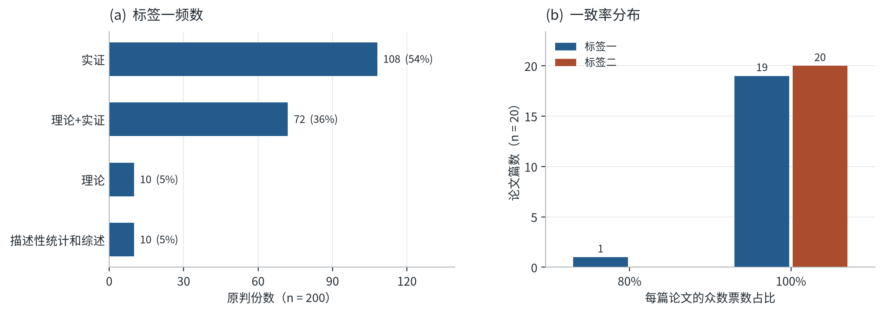
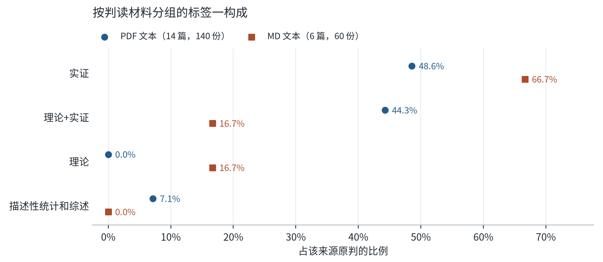
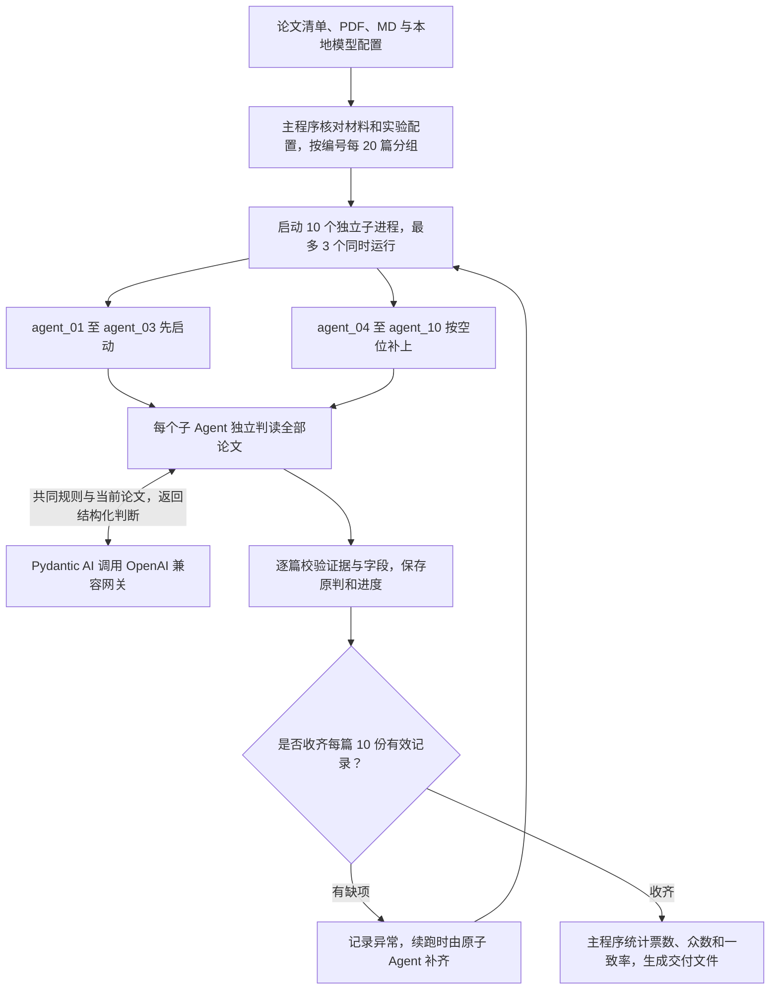
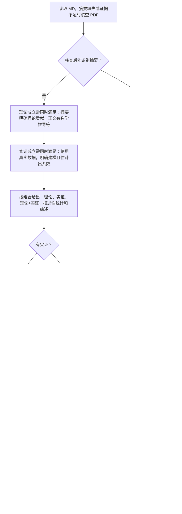

# Paper Scoring · 论文双标签独立判定

使用 Pydantic AI 对论文独立判定研究类型和经管属性，并保留逐篇依据、投票和人工复核材料。正式批次包含「新旧结果不一致」组的 20 篇论文。10 个子 Agent 各判读全部 20 篇，最多同时运行 3 个。

## 正式运行结果

本批次收齐 200 份原判，实测最高并发为 3。标签一有 19 篇全票一致，标签二的 20 篇均获 10 票「核心经管」，两个标签同时全票一致的有 19 篇。

- [正式结果目录](results/formal-run/) · [Excel 汇总](results/formal-run/标签一二-10个Agent独立打标汇总.xlsx) · [逐 Agent PDF](results/formal-run/PDF-每组详细判定/) · [逐 Agent Markdown](results/formal-run/MD-每组详细判定/)
- [独立验收 PDF](results/formal-run/独立验收与抽查报告.pdf) · [独立验收 Markdown](results/formal-run/独立验收与抽查报告.md) · [程序验收](results/formal-run/验收报告.md) · [不一致论文复核](results/formal-run/不一致论文复核.md)
- [运行配置与 200 条原判 JSON](results/formal-run/provenance/)

请整目录下载或克隆仓库后打开 Excel。工作簿中的 400 个链接使用相对路径，需要与两个明细目录放在一起。

### 标签分布与一致率



每篇的一致率按该篇最多票标签的票数除以 10 计算。037 是唯一分票的论文，标签一获 8 票「实证」和 2 票「理论+实证」。独立抽查发现，017 的全票理论判定将正文里的建模贡献归给了摘要，020 的全票理论判定缺少充分的正文推导证据。正式结果保留原判，Excel 的人工结果栏留空。

### 标签构成与判读材料



各比例以同组原判数为分母。同篇论文的 10 份原判都使用了相同的材料路径，两组由不同论文组成。本批次有 14 篇使用 PDF 文本、6 篇使用 MD 文本，所有原判的页图清单为空。

[Matplotlib 绘图脚本](scripts/plot_results.py) 读取已发布的原判 JSON。安装 `matplotlib` 后，运行 `python scripts/plot_results.py` 可重新生成两张图。需要指定中文字体时可传 `--font <字体文件>`。

## 架构图 · 主程序与子 Agent



每个子进程创建一个具名的 Pydantic AI `Agent`。每次 `Agent.run()` 使用新上下文，包含共同规则、当前论文材料和必要的校验提示。主程序负责并发调度、断点续跑和一致率统计。框架选型见 [设计记录](docs/decisions/001-agent-framework.md)。

## 流程图 · 一篇论文如何打两个标签



PDF 文本仍无法支持判定时，子 Agent 可请求核查最多 4 张指定页图。材料不足时记录异常。模型提交步骤判断和证据，程序按照 [评分规则](paper_scoring/rubric.md) 校验并计算标签。[两张原图的 PDF](docs/agent-team-diagrams.pdf) 可单独下载。

## 安装和准备材料

需要 Python 3.11 或更高版本。进入克隆后的仓库目录，运行：

```bash
python3 -m venv .venv
source .venv/bin/activate
python -m pip install -e .
cp -n .env.example .env
```

在本地 `.env` 填写 `PAPER_SCORING_API_KEY`，其余配置可从 [.env.example](.env.example) 开始。已有同名系统环境变量时，系统环境变量优先。公开仓库只包含配置示例。

正式结果可直接查看。要重新判读，请按 [papers.toml](papers.toml) 放置有权使用的材料，或准备自己的清单。`pdf_dir`、`md_dir` 和 `instructions` 以清单所在目录为基准。每个编号需要一份 PDF 和一份 UTF-8 Markdown，两份文件使用相同的 `编号-标题` 文件名主体，例如 `017-论文标题.pdf` 和 `017-论文标题.md`。`ids` 保留前导零。文件名中的标题被截断时，可用 `[titles]` 补齐。

正式批次的源论文和指令 PDF 需在本地提供。自定义批次可省略 `instructions` 字段。该字段用于记录正式指令的文件指纹，实际执行的判定规则随源码提供。

## 运行与续跑

```bash
python -m paper_scoring check
python -m paper_scoring doctor
python -m paper_scoring run --smoke
python -m paper_scoring run
```

| 命令 | 用途 |
| --- | --- |
| `check` | 本地核对材料配对和可读性，无需 API Key。 |
| `doctor` | 用合成内容检查网关模型列表、JSON 响应和已启用的页图能力，可能产生少量费用。 |
| `run --smoke` | 1 个 Agent 判读清单首篇，默认写入 `runs/smoke/`。 |
| `run` | 10 个 Agent 各判读整份清单，默认写入 `runs/新旧结果不一致-标签一二/`。 |

两种 `run` 都会向所配置的网关提交论文文本及必要页图，并产生 API 费用。`check` 和 `run` 支持 `--manifest <文件>`。`doctor` 和 `run` 支持 `--env-file <文件>`。`run --jobs 1` 或 `run --jobs 2` 可降低并发。

中断或有漏篇时，使用相同模型配置和原 `--run-dir` 重跑，程序只补尚无有效原判的论文。新运行目录下会生成以下内容：

- `00_任务清单/` 保存分组、材料指纹和实验配置。
- `01_Agent工作区/` 保存分 Agent 的单篇 JSON、进度、异常与本机会话记录。
- `04_汇总结果/` 保存程序验收报告。结果收齐后生成明细、Excel 汇总和不一致论文复核清单。

## 切换模型或网关

1. 在本地 `.env` 将 `PAPER_SCORING_MODEL` 改为网关实际提供的模型 ID。示例使用 `deepseek-v4.1-flash`。
2. 更换网关时，将 `PAPER_SCORING_BASE_URL` 改为该网关的 OpenAI 兼容 API 基础地址，并将 `PAPER_SCORING_API_KEY` 改为对应凭据。仅使用文本模型时，将 `PAPER_SCORING_PDF_IMAGES` 设为 `false`。需要页图才能完成的判读会记录异常。
3. 先运行 `doctor`，再分别为试跑和正式判读指定新目录。原运行目录绑定原模型配置，用于原实验续跑。

```bash
python -m paper_scoring doctor
python -m paper_scoring run --smoke --run-dir runs/alternative-model-smoke
python -m paper_scoring run --run-dir runs/alternative-model
```

网关需要支持 Chat Completions 和 JSON 对象输出。当前适配器发送 `thinking.type=disabled` 和 `reasoning_effort=none`。如果新网关拒绝这些字段，需要按其接口调整 [模型适配器](paper_scoring/judge.py) 后重新做兼容检查。

## 本地测试

```bash
python -m unittest discover -s tests -v
```

测试使用合成论文和本机模拟网关，无需真实 API Key。
